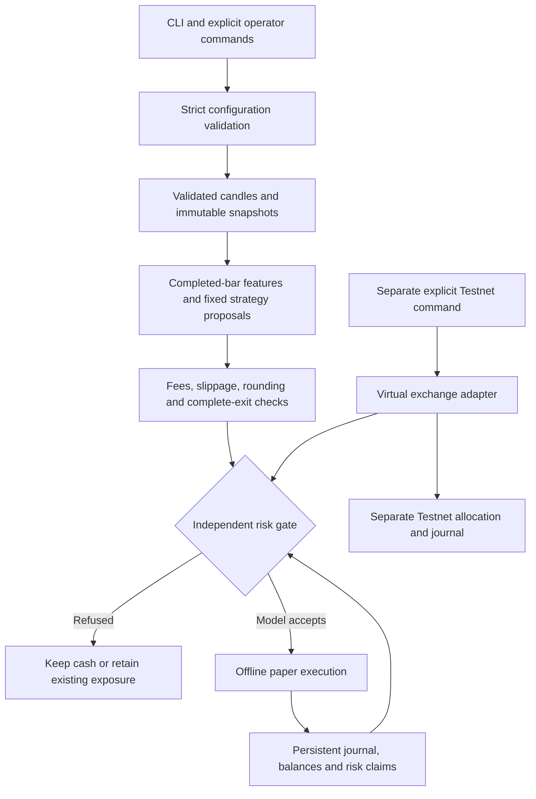
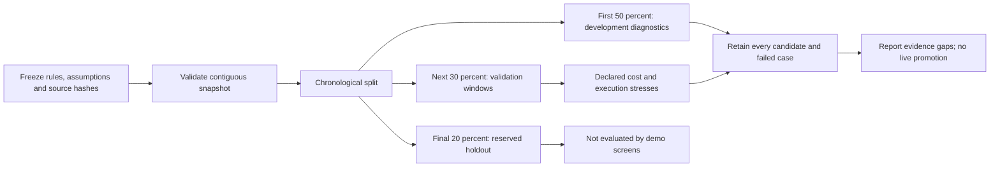
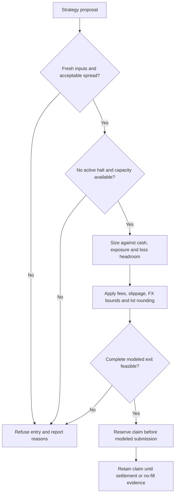
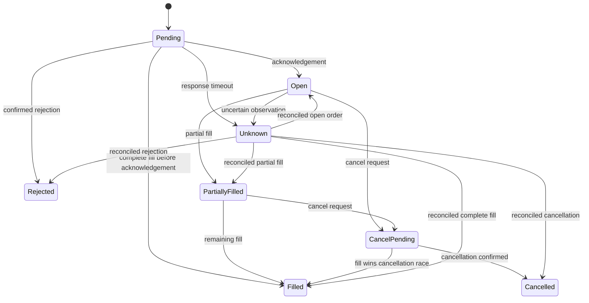
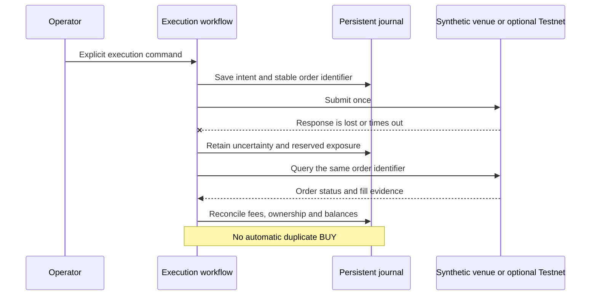

# Marvel Trading Demo

**Bitcoin strategy research, independent risk controls, persistent paper accounting, and optional virtual exchange execution.**

An educational Python project for studying trading-system engineering with a $50 simulated allocation. The default demo runs offline with invented data: no API key, paid service, package download or real-money deposit is needed.

No profitable strategy, long-duration uptime record or guaranteed loss ceiling has been demonstrated. The operational layer includes a gated production Spot connector and bounded online strategy selection. Synthetic results and Testnet fills demonstrate engineering behavior, not real trading returns.

## Operational implementation: version 0.6.0

The new `marvel_ops` package connects historical validation, prospective paper observations, adaptive strategy selection, persistent order execution and service operation. The original research and isolated Testnet packages remain available.

| Requested goal | Implemented code | Evidence status |
| --- | --- | --- |
| Profitable strategy after costs | Development screens, immutable final-holdout attempts, cost stresses, bootstrap and neighbor checks | No real candidate has qualified in this release |
| Complete small-position exits | Fee-aware preflight, own-inventory reconciliation, stops, cancellation-race handling and retained residuals | Infeasible small orders are blocked; actual production exits remain unqualified |
| Forward and Testnet evidence | Timely prospective paper broker and authenticated virtual settlement collector | Real elapsed time and authenticated observations still required |
| Real-money execution and continuous operation | Fixed-host Spot adapter, durable intents, reconciliation, worker, health, backup and service templates | Live entry is gated; no real-money order or continuous deployment is claimed |
| Automatic learning and adaptation | Regime-dependent rolling net-outcome scores and bounded strategy selection | Implemented and tested with invented outcomes; future profitability unknown |

**This is an engineering milestone, not a claim that the financial goals have already been achieved.** Missing evidence is shown by a computed readiness report; the code cannot turn it into success by changing a README.

```text
python -m marvel_ops init
python -m marvel_ops status
python -m marvel_ops readiness
```

Use the Python 3.12 executable from the quick start below in place of `python`. Full architecture, live/Testnet controls, research release criteria and service instructions are in [the operational guide](docs/OPERATIONS.md).

## Quick start

Use **CPython 3.12**. The application and tests use the standard library; no `pip install` step is required. Run commands from this repository's root.

Windows PowerShell:

```powershell
py -3.12 -m venv --without-pip .venv
.\.venv\Scripts\python.exe -m marvel validate
.\.venv\Scripts\python.exe -m marvel init
.\.venv\Scripts\python.exe -m marvel status
.\.venv\Scripts\python.exe scripts/run_demo.py
```

Linux or macOS, with Python 3.12 installed:

```bash
python3.12 -m venv --without-pip .venv
.venv/bin/python -m marvel validate
.venv/bin/python -m marvel init
.venv/bin/python -m marvel status
.venv/bin/python scripts/run_demo.py
```

`init` explicitly creates or verifies a local $50 simulated account. Repeating it does not restore capital or clear halts. `run_demo.py` uses a disposable source copy and separate state, leaving an existing account unchanged.

The one-command demonstration validates configuration, exercises paper fills/timeouts/recovery, screens three fixed breakout variants on synthetic candles, and exercises conversion-cleanup and risk-bound cycle scenarios. Its JSON summary keeps `strategy_qualified` and `live_execution_available` false.

## System architecture

Strategies propose actions. Independent feasibility and risk checks decide whether a proposal fits the model. Execution and accounting preserve what happened, including uncertainty and unsellable holdings.



This diagram shows shared responsibilities. The historical broker, public paper adapter and Testnet workflow have separate execution contexts and stores. A model risk check never grants production execution permission.

| Layer | Responsibility | Boundary |
| --- | --- | --- |
| Data | Validate prices, timestamps, coverage, hashes and provenance | Do not fill gaps with invented market prices |
| Features | Use completed candles and available prefixes | Do not read future bars to decide earlier entries |
| Research | Evaluate fixed hypotheses and retain failed scenarios | Do not choose a live winner automatically |
| Feasibility | Model costs, grids, minimums and full liquidation | Do not discard dust to make a trade appear closed |
| Risk | Size proposals against independent budgets | Strategies cannot increase their own limits |
| Execution | Handle explicit order, fill and cancellation evidence | A missing acknowledgement is not proof of failure |
| Accounting | Persist cash, ownership, fees and unresolved claims | Do not reset capital or erase uncertain exposure |

BTCUSDT is the implemented research instrument. Gold, NASDAQ100 and US30 are future identifiers with no implemented or qualified trading route. Public-demo timestamps use UTC.

## Code structure

```text
.
|-- config/
|   |-- paper.json                  # Illustrative capital and risk policy
|   `-- btc-paper-risk.json         # Illustrative grids, costs and fees
|-- marvel/
|   |-- cli.py                     # Commands and sanitized status output
|   |-- config.py                  # Closed schema and policy fingerprints
|   |-- state.py                   # SQLite state, migrations and halts
|   |-- events.py                  # Restricted structured logs
|   |-- data/                      # Validation, snapshots and causal replay
|   |-- risk/                      # Sizing, budgets and persistent claims
|   |-- paper/                     # Synthetic execution and settlement
|   `-- research/                  # Features, strategies, backtests and evidence
|-- marvel_testnet/                # Isolated virtual exchange adapter
|-- marvel_ops/                    # Integrated validation, learning, execution and service
|-- deploy/                        # Generic paper-service and Windows-runner templates
|-- scripts/                      # Demo runner, verification and source packaging
|-- tests/                        # Core behavior and regression tests
|-- tests_testnet/                # Mocked exchange and recovery tests
|-- tests_public/                 # Publication and privacy-boundary tests
|-- docs/                         # Architecture, phases and generic Testnet guide
|-- ci/offline-checks.yml          # Ready-to-activate Windows/Linux CI template
|-- PUBLIC_FILES.txt              # Explicit list of publishable source paths
`-- SECURITY.md                   # Credential and data-handling guidance
```

Important implementation entry points:

| File | What it implements |
| --- | --- |
| [Data quality](marvel/data/quality.py) | Strict JSON/CSV parsing, explicit time units, candle validation and causal replay |
| [Snapshot store](marvel/data/store.py) | Raw/normalized evidence, hashes, manifests and provenance |
| [Risk engine](marvel/risk/engine.py) | Headroom, sizing, commitments, valuations and persistent financial halts |
| [Risk model](marvel/risk/model.py) | Decimal amounts, request validation, rounding and illustrative profiles |
| [Paper ledger](marvel/paper/ledger.py) | Order states, fills, cancellation races, fees and ownership |
| [Research features](marvel/research/features.py) | Completed-bar aggregation, trend context, breakout signals and ATR stops |
| [Additional rules](marvel/research/rules.py) | Trend pullback, cost-filtered breakout and range rebound |
| [Historical broker](marvel/research/backtest.py) | Costed simulation and hypothetical portfolio accounting |
| [Research studies](marvel/research/study.py) | Frozen candidates, chronological splits, gates and retained failures |
| [Metrics](marvel/research/metrics.py) | Net results, drawdown, validation windows and bootstrap diagnostics |
| [Forward observer](marvel/research/forward.py) | Frozen prospective signal collection without orders or fills |
| [Testnet workflow](marvel_testnet/workflow.py) | Preflight, one bounded virtual cycle, reconciliation and recovery |
| [Testnet transport](marvel_testnet/transport.py) | Fixed-host requests, HMAC signing, route restrictions and sanitized receipts |
| [Publication policy](scripts/public_files.py) | Reviewed file selection, private-pattern checks and source-only ZIP creation |
| [Operational execution](marvel_ops/execution.py) | Risk-gated entry, actual fill accounting, venue protection and reduction-only close |
| [Online learning](marvel_ops/learning.py) | Completed-outcome scoring, provenance separation and regime-dependent selection |
| [Prospective paper](marvel_ops/forward.py) | Timely observations, persistent hypothetical broker and retained gaps |
| [Qualification](marvel_ops/validation.py) | Frozen validation/holdout reports and evidence-derived live release gates |
| [Service worker](marvel_ops/service.py) | Exclusive worker, heartbeat, backoff, graceful stop and persistent failure halts |

## Our approach

1. **Start with reproducible behavior.** Fixed cards and invented fixtures make errors easier to isolate. The bounded selector updates outcome scores without changing card parameters or risk limits.
2. **Check feasibility before evaluating a signal.** Entry fees, lot sizes, minimums and a complete exit must fit the small allocation.
3. **Keep risk independent.** A strategy supplies proposals; another layer enforces budgets, stale-input checks and exposure limits.
4. **Retain inconvenient outcomes.** Losses, rejected entries, zero-trade rules, uncertain orders and residual assets remain visible.
5. **Separate evidence types.** Synthetic tests, historical models, prospective observations and virtual exchange fills answer different questions.
6. **Advance only with evidence.** Software tests cannot establish profitability, production costs, provider availability or unattended reliability.

A signal can look attractive while its resulting tiny holding cannot be sold. A timed-out order can still have filled. A stop can be accepted without executing at the expected price. These cases drive the design of the risk and recovery layers.

## Strategy research

### Implemented hypotheses

| Family | Variants | Basic idea |
| --- | --- | --- |
| Baseline breakout | 1-hour, 4-hour and daily | Exceed prior highs with completed 4-hour trend context, an ATR stop and a prior-low exit |
| Trend pullback | 1-hour | Recover above a recent mean inside a rising completed 4-hour trend |
| Cost-filtered breakout | 1-hour | Require breakout conditions and a fixed volatility hurdle; the hurdle is not a return forecast |
| Range rebound | 1-hour | Recover from a lower band near relatively flat trend context |

The default research demo screens three baseline variants. Separate comparison tools evaluate the three additional families. The original observation-only protocol can record all six. The operational worker can select among fixed cards; live entries require independent historical, forward, Testnet and operator gates.

### Chronological evaluation



Features use completed bars. Historical entries follow a delayed convention: a signal waits one full hourly bar before the next modeled open. Spread, slippage, fees, FX bounds and intrabar behavior are explicit assumptions. The model attempts to flatten at 23:00 UTC and blocks new entries from 22:00 UTC; unresolved holdings and halts are retained.

Baseline stresses include doubled spread/slippage and higher assumed fees. Proxy/comparison experiments also include doubled fees, missed entries and a BTC entry-fee fallback. These are declared hypotheses rather than observed production costs.

Reports retain net results after modeled costs, drawdown, six validation windows, trade counts, bootstrap diagnostics, remaining exposure and model termination. The plan requires more evidence, including sufficient out-of-sample trades and an untouched final holdout. Missing financial qualifications remain false even when a diagnostic number is positive.

Two illustrative reserved date ranges use placeholder catalogue identities. No actual historical dataset or private study is distributed. Real-data proxy work needs a reviewed pre-registered catalogue and permitted data access; synthetic snapshots are sufficient for the public demo.

### Monitoring and future adaptation

The forward observer records new public signals under a frozen protocol. Late/missed hours stay visible; old observations are not replayed as timely decisions. It creates neither fills nor a performance record. Source or financial-setting changes can stop collection, and cloning this repository starts no background worker.

The operational layer now adds persistent prospective paper execution, a bounded regime-dependent learner and worker supervision code. New-strategy generation and news/world-event analysis remain future work. The learner cannot loosen limits; production selection is restricted to qualified cards and actual completed-outcome provenance. Deployment and sustained uptime must still be observed.

## Risk controls and small-position costs

| Illustrative setting | Default |
| --- | ---: |
| Initial simulated capital | $50 |
| Planned risk ceiling per trade | $1 |
| Daily loss ceiling | $5 |
| Rolling seven-day loss limit | 2% |
| Peak drawdown limit | 5% |
| Maximum position notional | 20% of the lower of initial/current equity |
| Concurrent positions | 1 |
| Losing-streak halt | 3 |

**The tightest remaining limit wins.** Initially the rolling loss ceiling is $1 and the exposure ceiling is $10. The daily ceiling cannot override smaller weekly or drawdown headroom. Pending orders and unresolved holdings continue to consume their commitments.

Sizing accounts for fees, adverse slippage, illustrative FX bounds, rounding and complete-exit feasibility. Monetary arithmetic uses Decimal. A modeled risk ceiling cannot guarantee a maximum realized loss during a gap, outage or failed exit.



### Why a tiny position can be infeasible

The default illustrative profile charges entry fees in BTC. A purely invented quantity example:

```text
Gross BTC bought:              0.00010000
Entry fee at 0.1 percent:      0.00000010 BTC
Net BTC owned:                0.00009990
Permitted sell step:          0.00001000
Grid-aligned quantity:        0.00009000
Remaining holding:            0.00000990 BTC
```

A remaining holding below the venue grid or minimum stays owned. The code does not round a sale upward, sell unrelated inventory, discard dust or label the account flat. Historical entry preflight can reject the proposed trade; the paper failure demonstration deliberately exercises unresolved dust.

## Order lifecycle and recovery

The paper layer processes explicit synthetic acknowledgements, fills, cancellation, timeout, recovery, quote and close events. It distinguishes observed order state from locally stored synthetic venue truth.



This is a simplified view of order evidence. A terminal BUY order can still leave owned BTC. Complete settlement requires known ownership, cash, fees, relevant terminal orders and matching accounting evidence.

### A missing acknowledgement



Offline recovery uses the simulator's saved venue state. Testnet recovery queries the exchange; the evidence types remain separate. Paper stops require explicit synthetic events. Testnet protection is a standalone order with unprotected intervals after entry and during cancellation/replacement. Stop acceptance does not guarantee a fill or its price.

## Persistence and reproducibility

| Mechanism | Purpose |
| --- | --- |
| Explicit idempotent initialization | Verify existing state instead of resetting balances |
| Decimal accounting | Avoid binary floating-point arithmetic for money and lots |
| SQLite transactions and journals | Persist state transitions and verify modeled accounting |
| Stable order/event identifiers | Prevent duplicate entries or repeated fill charges |
| Persistent claims and halts | Retain uncertainty, dust and financial restrictions across restart |
| Source/configuration fingerprints | Bind research and Testnet state to their implementation and policy |
| Separate stores | Keep paper, snapshots, studies, forward observations and Testnet allocation distinct |
| Conservative ownership | Retain unresolved assets even when modeled recovery value is zero |

Generated state belongs under ignored `var/` and `reports/`; disposable checks use ignored `.test-tmp/`. No pre-existing account, ledger, journal or research capture is shipped.

## Commands and optional Testnet

Use your Python 3.12 environment's executable in place of `python`:

| Command | Purpose |
| --- | --- |
| `python -m marvel validate` | Validate settings without initializing an account |
| `python -m marvel init` | Initialize or verify persistent simulated state |
| `python -m marvel status` | Inspect account state, limits and halts |
| `python -m marvel risk status` | Inspect remaining headroom and commitments |
| `python -m marvel risk example` | Build an invented short-lived risk request |
| `python -m marvel paper demo` | Exercise synthetic fills, uncertainty and dust |
| `python -m marvel research plan` | Inspect fixed rules, assumptions, splits and gates |
| `python -m marvel research demo` | Screen invented hourly candles |
| `python -m marvel research convert-demo` | Exercise invented cleanup outcomes |
| `python -m marvel research cycle-demo` | Exercise risk-bound entry, exit and cleanup |
| `python -m marvel --help` | Explore the full command surface |

`marvel_testnet` is a separate optional package for Binance Spot Testnet virtual assets. It uses a fixed host, hidden local prompts and a separate $50 allocation. Larger faucet balances do not enlarge that allocation. Offline examples and CI need no credentials.

```text
python -m marvel_testnet init
python -m marvel_testnet status
python -m marvel_testnet public-check --allow-network
python -m marvel_testnet preflight --allow-network --prompt-credentials
```

Preflight is GET-only. One manual virtual cycle needs passing checks and a separate explicit order opt-in. Reconciliation is GET-only; explicit recovery can reduce an owned holding and never buys. Missing evidence, unexpected account changes and Testnet resets require review. Bound source/configuration changes can block further actions.

See the [generic Testnet guide](docs/TESTNET.md) for the complete workflow. No real account identifiers, credential values, personal environment settings or production account setup are supplied.

Some core research modules support optional authenticated read-only metadata or non-accepting conversion quotes. They are separate from the quick start and CI. The original core does not submit production orders or accept conversions; the new `marvel_ops` production connector has separate explicit credentials, order acknowledgement and evidence gates. Offline examples and tests never invoke a funded account.

## Verification and CI

The earlier demo baseline ran **474 tests and 27 command checks**. Operational tests and command checks are included in the current runner; its generated local report records the actual current counts. Tests establish software behavior, not investment performance.

```text
python scripts/check_publish.py
python scripts/check_demo.py
```

The runner removes provider credential variables and blocks socket connections in its Python processes, including child processes. Fixtures contain invented prices, keys, accounts and provider responses. Coverage includes parsing, causal replay, risk budgets, accounting identities, partial fills, uncertain acknowledgements, cancellation races, restarts, dust and private-file exclusion.

The [GitHub Actions template](ci/offline-checks.yml) defines publication auditing, offline tests and source archive creation on Windows and Linux with Python 3.12. It requests read-only repository contents permission and needs no account secrets.

**The template is not installed as an active workflow.** The publishing login could create a repository and push code but lacked GitHub's separate workflow permission. To activate it later, copy the template to `.github/workflows/ci.yml` using an account/session permitted to manage Actions workflows, and update `PUBLIC_FILES.txt` and the exact-path list in `scripts/public_files.py` for that reviewed path. No hosted CI result is claimed by this publication; all reported checks were run locally.

## Privacy and publication

This repository is prepared from an explicit public source list. Private workspace evidence is excluded rather than copied and then redacted.

Excluded material includes credentials, secret/environment files, actual account observations and balances, private API responses, existing databases, local logs, downloaded market data, study outputs, research-session identifiers, personal machine paths, private network addresses and editor settings.

The audit checks reviewed paths, selected credential/private-path patterns, local documentation links and Git-tracked files outside the manifest. Ignore rules provide another boundary. These checks cannot certify arbitrary future edits; review staged changes before publication.

```text
python scripts/check_publish.py
python scripts/package_demo.py
```

The source-only archive is `dist/marvel-trading-demo.zip`. Its contents come from [PUBLIC_FILES.txt](PUBLIC_FILES.txt), never a recursive copy of the working directory. Runtime files stay excluded after running the demo. See [SECURITY.md](SECURITY.md) for handling local secrets and reporting problems without private records.

## Development phases and current limits

| Stage | Scope | Status |
| --- | --- | --- |
| Foundation | Strict config, CLI, persistent state and journals | Implemented |
| Data | Validated snapshots, provenance and causal replay | Implemented with synthetic fixtures |
| Risk | Sizing, costs, claims and persistent halts | Implemented for the model |
| Paper execution | Fills, cancellation, recovery and settlement | Implemented offline |
| Research | Fixed strategies, stresses, metrics and reserved samples | Implemented; profitability unproven |
| Virtual exchange | Separate Testnet preflight, cycle and recovery | Adapter implemented; provider outcomes need observation |
| Supervised operations | Worker, health, backoff, backup and service templates | Code implemented; deployment/uptime evidence pending |
| Production execution | Fixed-host Spot execution and evidence-derived authorization | Code implemented; funded use remains unqualified |
| Bounded adaptation | Regime-dependent completed-outcome scores and card selection | Code implemented; no profitable adaptation claim |

No proven profitable learner, news/world-event integration, automatic risk adjustment, hosted 24/7 service, guaranteed return or financially qualified production release is provided. The code for bounded learning and supervised execution does not establish those outcomes. Margin, futures, shorting, martingale and averaging down are outside the implemented demo. Keeping cash can be the correct result when costs or evidence do not support a trade.

Read the detailed [architecture](docs/ARCHITECTURE.md), [phase roadmap](docs/ROADMAP.md) and [Testnet guide](docs/TESTNET.md). Separately obtained market data remains subject to provider terms; no provider dataset is redistributed here.

The diagrams use Mermaid fences supported by [GitHub's diagram documentation](https://docs.github.com/en/get-started/writing-on-github/working-with-advanced-formatting/creating-diagrams). They describe implemented responsibilities or explicitly marked future work.
