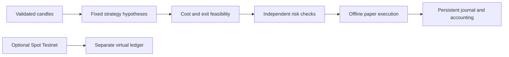

# Architecture

The project separates evidence collection, strategy proposals, risk decisions and execution. A signal cannot authorize a trade by itself. No component can turn a synthetic result into production qualification.

## Data and research

Snapshots retain raw and normalized hashes, provenance, time units and attribution. Replay uses completed candles. Research splits training, validation and a reserved final holdout; it does not evaluate the reserved tail. All fixed candidates and unsuccessful scenarios remain visible. Fees, spread, slippage and FX assumptions are explicit model inputs.

The public source contains two illustrative reserved date ranges and placeholder catalogue identities. They preserve guard behavior in tests, but do not approve an actual market-data import. Proxy and comparison commands work with synthetic snapshots; real-data proxy work needs a reviewed, pre-registered catalogue and lawful data access. No existing private study is shipped.

The forward observer can record public signals under a frozen protocol. It is observation only: signals are not simulated fills, finished trades or measured profitability. Source or financial-file changes block collection under an existing protocol. No background collector starts when this repository is cloned or tested.

## Risk and state

Money uses decimal arithmetic. Sizes are rounded down to allowed lots and checked again after costs. The risk engine checks notional, per-trade, daily, rolling-week, drawdown, streak, freshness and spread constraints. Incomplete fills and unresolved dust retain their claim on the risk budget.

SQLite stores persistent state and journals. Initialization is explicit and idempotent. Rejected or uncertain actions cannot erase ownership, replenish capital, silently retry entries or clear halts. The offline paper adapter models a venue locally; it does not establish actual exchange state.

## Optional exchange engineering

`marvel_testnet` has a separate allocation and journal. It restricts its destination to Binance Spot Testnet and only supports a small order/query surface. Network access and virtual-order submission require separate opt-ins. Stable client IDs and intent records precede submissions; reconciliation queries existing IDs after an uncertain acknowledgement.

Standalone protection creates an unprotected interval after entry and during replacement. A stop acknowledgement does not guarantee a fill. Testnet assets and execution behavior cannot qualify production costs, liquidity, permission, profitability or maximum losses.

## Runtime and tests

The code targets CPython 3.12 and uses the standard library. Public configuration contains only illustrative paper settings. Runtime data belongs under ignored `var/`; disposable checks use ignored `.test-tmp/`. All test credentials, exchange accounts and responses are invented fixtures. The offline runner blocks network connections in its Python processes.
