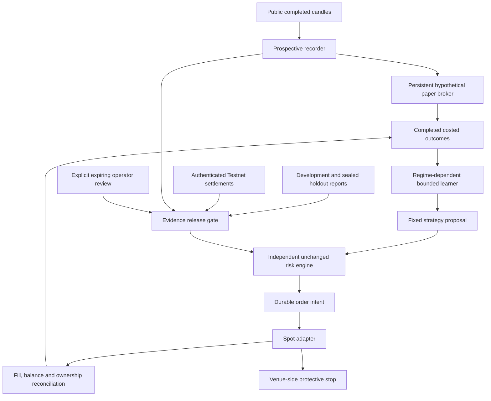

# Integrated operations

`marvel_ops` adds evidence-gated operational code to the original research and Testnet packages. It does not change the original private workspace, limits or accounts. All generated state remains under ignored `var/operations/`, with separate paper, Testnet and live journals.

## Five goals: implementation and evidence

| Goal | Implemented software | What code cannot establish by itself |
| --- | --- | --- |
| Profitable strategy after costs | Fixed development screen, cost stresses, immutable holdout attempt, bootstrap/drawdown checks | A real dataset must pass; synthetic profit is not proof |
| Complete small-position exits | Pre-entry full-exit grid search, actual fill reconciliation, own-inventory limits, persistent residuals and cancellation-race handling | Some small holdings are infeasible; no code can make an unsupported order valid |
| Forward paper and actual Testnet evidence | Timely public-price recorder with persistent paper broker; authenticated Testnet settlement receipts | Time must elapse and actual virtual fills must be observed with separate local credentials |
| Real-money execution and continuous operations | Fixed production Spot connector, durable order intents, venue stops, GET-only reconciliation, bounded close/rearm, worker and service templates | No funded order, deployment or uptime claim is made by offline tests |
| Automatic learning and adaptation | Regime-dependent online scores from completed net outcomes, rolling windows, positive-score filtering and separate evidence provenance | A selector cannot create an edge; no strategy may change the risk policy |

Engineering functionality and financial qualification are separate statuses. This project has not demonstrated the five financial/operational outcomes merely by implementing their code.

## Architecture



## Offline initialization

Use the Python 3.12 executable created in the main README in place of `python`:

```text
python -m marvel_ops init
python -m marvel_ops status
python -m marvel_ops readiness
python -m marvel_ops health
```

Initialization is idempotent. There is no capital reset, halt-clear or force-qualification command. `pause` persists an operator halt; it does not pretend to have closed holdings.

## Prospective paper collection

```text
python -m marvel_ops worker --allow-network
```

This default paper worker uses public production-market prices, needs no API credentials and cannot send exchange orders. It checks completed hourly candles and records capture time. The initial snapshot is warm-up. A later capture must arrive within 180 seconds after its bar end, without a missed-hour gap, to qualify as a timely decision. Missed observations are not backfilled into a performance record.

The paper broker remains a hypothetical OHLCV execution model with costs, conservative FX bounds, continuous risk history and retained halts. Its state is restored after restart. New signals wait an entire hour before a modeled entry. One-bar shadow scores help compare rules but are never counted as completed portfolio trades. Synthetic provenance cannot count as actual forward evidence. Default BTC-fee assumptions can correctly refuse every small entry.

The worker polls every 20 seconds, backs off after failures, persists health, and latches a review halt after three consecutive failures. It monitors/reconciles before considering entries. A bar is consumed before an exchange entry attempt so a failed tick cannot silently retry that entry. Venue protection and known holdings are managed separately from entry qualification.

Inspect `health`; a heartbeat older than 120 seconds is unhealthy. `backup` creates a consistent SQLite backup, without deleting history or replenishing capital. New entries stop at journal/history limits; preserve records for reviewed maintenance. Monitoring cannot guarantee an exit during a network/provider outage.

## Historical qualification and the final holdout

Use a snapshot ID returned by an explicit local import or synthetic research demo:

```text
python -m marvel_ops validate --dataset <snapshot-id>
```

This saves the full original costed study and its fixed-candidate development checks. It does not touch final holdout analytics. Synthetic or unsuccessful development samples cannot advance.

For a genuinely successful real-data development screen only:

```text
python -m marvel_ops finalize-validation --development-record <record-id> --acknowledge-holdout
```

The selected fixed card and criteria are recorded before holdout access. Only one holdout attempt is allowed per dataset. The holdout requires positive net results across declared cost stresses, at least 50 closed trades, a positive bootstrap lower bound, drawdown below 5%, no remaining position, and positive neighboring-breakout diagnostics. It remains conditional on the stated cost model. It does not verify historical provider costs, data rights or FX observations.

## Testnet execution

```text
python -m marvel_ops --mode testnet init
python -m marvel_ops --mode testnet preflight --stop-price <price> --allow-network --prompt-credentials
python -m marvel_ops --mode testnet enter --stop-price <price> --strategy btc-breakout-1h-v1 --allow-network --prompt-credentials --acknowledge-orders
python -m marvel_ops --mode testnet reconcile --allow-network --prompt-credentials
python -m marvel_ops --mode testnet close --allow-network --prompt-credentials --acknowledge-orders
```

Use dedicated Testnet HMAC credentials only in the hidden local prompts. The older `marvel_testnet` package remains separately supported; its invented tests are not imported as actual settlements for the new release gate.

Entry intent and a stable client ID are committed before submission. The adapter queries order and trade evidence after a missing acknowledgement instead of buying again. It calculates actual attributed BTC and quote deltas, verifies baseline balances, and never sells unrelated faucet inventory. Unexpected fee assets, external balance changes, dust, unknown orders and failed stop acknowledgement retain review halts.

`reconcile` is GET-only. `close` cancels confirmed owned orders, reconciles any racing stop fill, and sells only the remaining owned quantity. A failed exit can attempt one protective rearm; it cannot clear its review halt. Standalone stops create unprotected intervals and do not guarantee prices. A gap can exceed the planned loss. A holding below a new-order minimum stays owned rather than being discarded.

The integrated worker can run in Testnet mode with explicit order acknowledgement. It learns from settled attributed outcomes, retains the current strategy for an open position, and always restores/reconciles an existing position before any entry decision.

## Production connector and release policy

The connector supports only fixed Binance Spot hosts and a narrow BTCUSDT order/query surface. There are no withdrawal, deposit, futures, margin or Convert routes. Live mutations require an explicit mode, order acknowledgement, local credentials, and a callback checking a durable owned order intent on every mutation.

Live BUY authorization additionally requires:

1. A qualifying real-data development/holdout report bound to current source, profile and risk policy.
2. At least 200 timely completed prospective paper trades spanning at least 30 days, with positive aggregate modeled net P&L.
3. At least ten balanced, filled Testnet settlements from the actual authenticated connector. Mocked responses never count.
4. Explicit operator review of provider access, data rights, actual costs and USD/USDT accounting. This review is an operator attestation, not automatic verification of those facts, and expires after 24 hours.
5. No review halt or changed source/configuration binding. The unchanged independent loss/exposure checks run again before submission.

`release --acknowledge-live-risk --confirm-provider-data-cost-fx-review` records the operator review in live mode. It cannot override any missing evidence or loosen limits. Live `enter`, `worker`, `reconcile`, and `close` use the same explicit argument patterns as Testnet with `--mode live`; do not treat a code example as authorization to fund or trade an account. No live order was needed to develop this module.

Existing positions may still be reduced when a new-entry release expires. Unknown ownership cannot be sold. Baseline inventory and account associations remain bound to the ledger. Private balances, receipts and learning outcomes are never committed to the repository.

## Service operation

The provided [systemd user-service template](../deploy/marvel-paper.service) runs the public-price paper worker and restarts failures. It assumes a checkout at a generic home-directory path; adjust it locally before installing, initialize the paper journal first, and use your operating system's service tools to start/enable it. No service is installed by cloning this repository.

The [Windows runner](../deploy/run-paper.ps1) derives its project location and can be launched manually or by a locally configured Task Scheduler task with restart-on-failure settings. `-Once` performs one tick. Power, internet, service activation and long-duration observation are operational dependencies.

Unattended exchange workers may opt into `--process-credentials` instead of hidden prompts. Supply the matching `MARVEL_OPS_TESTNET_API_KEY`/`MARVEL_OPS_TESTNET_API_SECRET` or `MARVEL_OPS_LIVE_API_KEY`/`MARVEL_OPS_LIVE_API_SECRET` only through the service's private process environment. No environment file, key value or personal account setup is distributed. The two credential-source options are mutually exclusive. Protect service credentials with the operating system and never put them in a command, tracked file or repository secret for these offline tests.

## Evidence limits

Local journals detect accidental alteration and retain receipts; they are not an independent audit or a cryptographic provider attestation. Public-price paper fills are modeled, market-data permissions remain separate, selection scores do not adjust for every statistical bias, and future returns are unknown. Long-duration uptime, actual Testnet observations, full real-fee/partial-exit qualification and profitability must be measured, never fabricated in a README.

API design references: Binance's official [Spot trading endpoints](https://developers.binance.com/docs/binance-spot-api-docs/rest-api/trading-endpoints), [account endpoints](https://developers.binance.com/docs/binance-spot-api-docs/rest-api/account-endpoints), and [symbol filters](https://developers.binance.com/docs/binance-spot-api-docs/filters).
